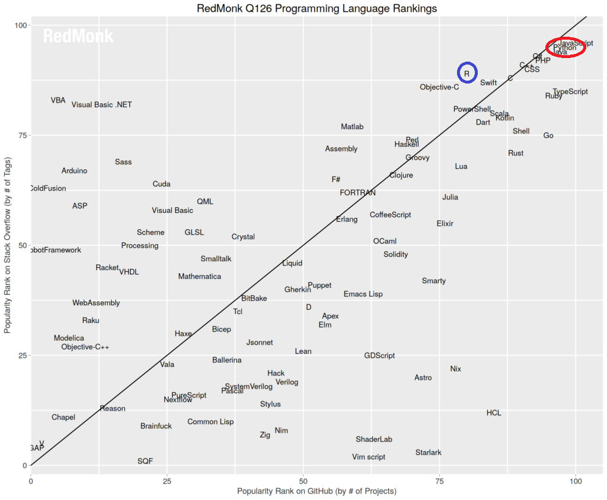
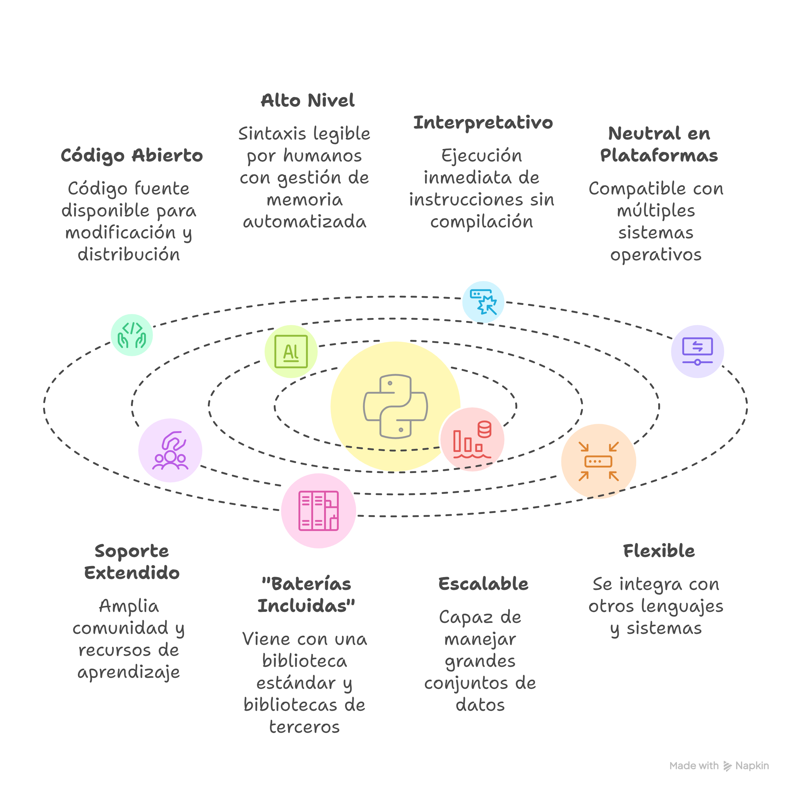
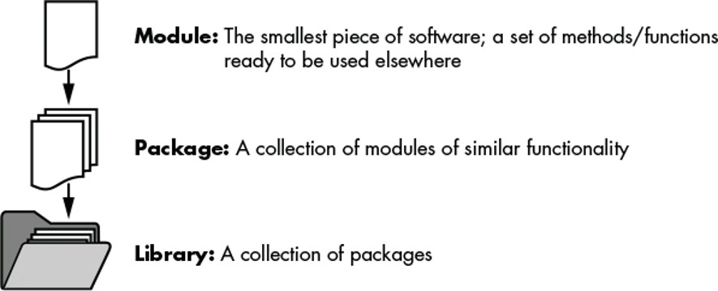
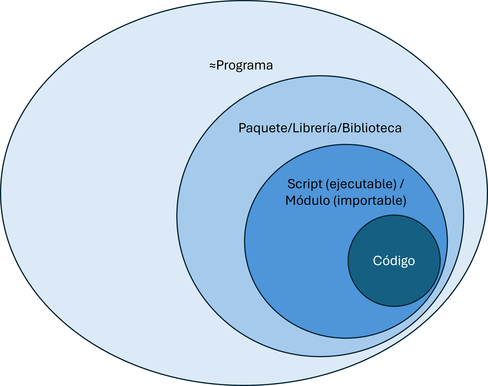
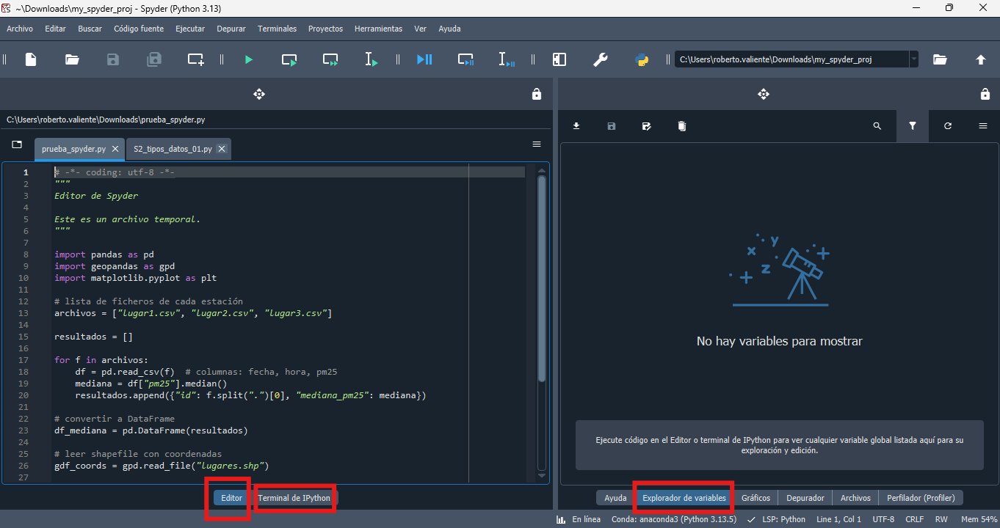

+-----------------------------------------------------------+-----------------------------:+
| **Fundamentos de Programación TIG** <br>                  |  |
| Máster en Tecnologías de la Información Geográfica (TIG)  |                              |
| Universidad de Alcalá                                     |                              |
+-----------------------------------------------------------+------------------------------+

------------------------------------------------------------------------

<br>
<br>

## ¿Qué es Python? ¿Por qué Python?

Python es en la actualidad uno de los lenguajes de programación más usados del mundo. Según el ranking RedMonk de lenguajes de programación en 2026 ([O'Grady](https://redmonk.com/sogrady/2026/04/14/language-rankings-1-26/)), Python fue el segundo lenguaje de programación más usado en volumen de proyectos y comentarios en el foro [StackOverflow](https://stackoverflow.com/questions).

{#fig-01_003 fig-cap="Ranking RedMonk de lenguajes de programación (2026)." fig-align="center" width="75%"}

La gran popularidad de Python se debe, en buena medida, a las características que lo convierten en un lenguaje versátil y accesible para diferentes tipos de usuarios y aplicaciones. Python es un lenguaje de programación de **código abierto** (*open source*), cuyo desarrollo está respaldado por una comunidad internacional de programadores, investigadores, voluntarios, empresas y organizaciones. Esto favorece su evolución continua y permite que cualquier persona pueda utilizarlo, desarrollar aplicaciones y contribuir a ampliar sus funcionalidades.

Python es, además, un lenguaje de programación **multipropósito**, **interpretado**, de **alto nivel** y **multiparadigma**. Veamos qué significa cada una de estas características.

<br>

**Lenguaje multipropósito**

Python es un lenguaje multipropósito porque puede utilizarse para desarrollar aplicaciones muy diversas, desde pequeños scripts para automatizar tareas hasta sistemas complejos de análisis de datos o aplicaciones web. Entre sus principales ámbitos de aplicación destacan:

-   *Análisis de datos y aprendizaje automático (Machine Learning)*: permite realizar procesos de preparación y transformación de datos (data wrangling), cálculos estadísticos, visualización de información y desarrollo de algoritmos de aprendizaje automático e inteligencia artificial.

-   *Análisis geoespacial*: dispone de un amplio ecosistema de bibliotecas para el tratamiento y análisis de información geográfica. Además, está integrado en herramientas SIG de uso habitual, como QGIS (PyQGIS) y ArcGIS (ArcPy), lo que permite automatizar procesos y desarrollar análisis espaciales complejos. Esto lo trabajaremos en el tema 4.

-   *Automatización de tareas (scripting)*: facilita la automatización de procesos repetitivos, la gestión de archivos, la descarga y transformación de datos y la ejecución de flujos de trabajo.

-   *Desarrollo web y de software:* permite desarrollar la parte interna (back-end) de sitios web y aplicaciones mediante herramientas como Django o Flask. Estas tecnologías facilitan el procesamiento de datos en servidores, la comunicación con bases de datos y la gestión de las peticiones de los usuarios. Un ejemplo de aplicación web cartográfica enteramente desarrollada con Python es [CRESHMap](https://creshmap.com/).

-   *Big Data*: puede utilizarse para procesar y analizar grandes volúmenes de información, especialmente mediante bibliotecas y herramientas especializadas que permiten distribuir o acelerar los cálculos.

    <br>

**Lenguaje interpretado**

Python es un lenguaje interpretado, lo que significa que su código fuente no necesita ser compilado previamente por el usuario en un ejecutable independiente para poder ejecutarse. La compilación es el proceso mediante el cual el código escrito en un lenguaje de programación se traduce a otro formato que el ordenador puede ejecutar o procesar de forma más directa, normalmente código máquina o código intermedio. Python cuenta con un **intérprete** que procesa directametne el código y ejecuta las instrucciones a través de su entorno de ejecución.

Esta característica ofrece algunas ventajas:

-   *Interactividad*: permite ejecutar instrucciones de forma individual y comprobar inmediatamente sus resultados, por ejemplo, desde una consola interactiva como IPython.

-   *Retroalimentación inmediata (feedback)*: facilita probar fragmentos de código y observar los resultados sin necesidad de ejecutar un programa completo.

-   *Detección de errores durante la ejecución*: los errores que se producen al ejecutar una instrucción pueden identificarse en ese momento, lo que facilita el proceso de desarrollo y depuración.

Este funcionamiento es similar al que encontramos en R, que también permite trabajar de forma interactiva desde una consola.

<br>

**Lenguaje de alto nivel**

Python es un lenguaje de alto nivel porque su sintaxis está diseñada para resultar relativamente sencilla, legible y cercana a la forma en que las personas expresamos las instrucciones. A diferencia de los lenguajes de bajo nivel, no es necesario gestionar directamente muchos de los detalles internos del funcionamiento del ordenador.

Entre sus principales características destacan:

-   *Simplicidad sintáctica*: utiliza una sintaxis relativamente sencilla y reduce la cantidad de código necesaria para realizar determinadas operaciones.

-   *Legibilidad*: su estructura y convenciones favorecen que el código sea fácil de leer, comprender y mantener.

-   *Abstracción*: muchos aspectos del funcionamiento interno del sistema, como la gestión de memoria, están automatizados y no necesitan ser controlados directamente por el programador.

Al igual que R, Python es un lenguaje de alto nivel, lo que facilita su aprendizaje y permite centrarse en la resolución de problemas sin tener que gestionar numerosos detalles técnicos del ordenador.

<br>

**Lenguaje multiparadigma**

Python es un lenguaje multiparadigma porque permite desarrollar programas siguiendo diferentes enfoques o estilos de programación. Los tres paradigmas más relevantes son:

-   *Programación procedimental*: organiza el código como una secuencia de instrucciones y funciones que realizan operaciones sobre los datos. El programa se construye a partir de una serie de pasos que permiten resolver un problema.

-   *Programación orientada a objetos (POO)*: organiza el código en torno a objetos que combinan datos (atributos) y comportamientos (métodos). Los objetos representan entidades con características y operaciones propias.

-   *Programación funcional*: se basa en el uso de funciones como elementos centrales del programa. Favorece la utilización de funciones que reciben datos y devuelven resultados, evitando modificar innecesariamente el estado de los objetos o del programa.

Aunque Python permite utilizar los tres paradigmas y combinarlos en un mismo programa, ofrece un soporte destacado para la programación orientada a objetos. Por su parte, R también es un lenguaje multiparadigma, aunque en el análisis de datos es habitual encontrar un estilo de programación más próximo al paradigma funcional, especialmente cuando se trabaja con funciones encadenadas para transformar y analizar información.

<br>

**Otras características de Python**

Además de las anteriores, existen otras características que contribuyen a explicar la popularidad y utilidad de Python:

-   *Multiplataforma*: es compatible con los principales sistemas operativos (Windows, macOS y Linux), por lo que permite desarrollar y ejecutar código en diferentes entornos.

-   *Amplio soporte y comunidad*: al ser un lenguaje de código abierto, cuenta con una comunidad internacional muy activa, abundantes recursos de aprendizaje, documentación y foros de consulta.

-   «*Pilas incluidas*» (*batteries included*): dispone de una biblioteca estándar con numerosas herramientas incorporadas para realizar tareas habituales. Además, cuenta con un amplio ecosistema de bibliotecas y paquetes desarrollados por terceros que permiten ampliar sus funcionalidades.

-   *Escalabilidad*: puede utilizarse tanto para desarrollar pequeños scripts como para construir aplicaciones y flujos de trabajo complejos. Además, dispone de herramientas especializadas para trabajar con grandes volúmenes de datos y distribuir los cálculos.

-   *Flexibilidad e interoperabilidad*: permite integrarse con otros lenguajes de programación y tecnologías, lo que facilita combinar diferentes herramientas y aprovechar sus respectivas ventajas.

La siguiente figura resume e ilustra las principales características de Python y algunos de los motivos por los que se ha convertido en uno de los lenguajes de programación más utilizados en ámbitos como la ciencia, la investigación y las tecnologías de la información geográfica.

{#fig-01_004 fig-cap="¿Por qué utilizar Python?" fig-align="center" width="70%"}

<br>

## Repasando los conceptos básicos de programación

Antes de empezar a trabajar con Python, conviene repasar algunos conceptos básicos de programación que utilizaremos a lo largo de la asignatura. Aunque algunos términos pueden resultar familiares por vuestra experiencia previa con otros lenguajes, es importante tener claras sus diferencias y comprender cómo se relacionan entre sí. Este repaso nos servirá para establecer una base común y facilitar la comprensión de los contenidos que iremos desarrollando en los siguientes temas.

<br>

### Elementos de código y ejecución

En este apartado repasaremos los principales elementos que intervienen en la escritura y organización del código Python, desde las instrucciones individuales hasta los programas completos. También veremos cómo se relacionan conceptos como script, módulo, paquete, librería, función, método, clase y objeto, que utilizaremos habitualmente a lo largo de la asignatura.

Principales definiciones:

-   **Programa**: Conjunto completo de instrucciones que resuelven un problema o automatizan una tarea. Ejemplo: un programa que descarga datos, los limpia y genera un mapa.

-   **Código**: Conjunto de instrucciones escritas en Python que ejecutan una tarea. Es la “materia prima” de un programa. Concepto general (escrito dentro de un programa, módulo, script o función).

-   **Script**: Archivo de texto con extensión .py que contiene código Python que puede ejecutarse.

-   **Módulo**: Archivo .py que contiene funciones, clases o variables y se puede importar en otros programas.

-   **Paquete**: Conjunto de módulos ya desarrollados que extienden las capacidades de Python.

-   **Librería / Biblioteca**: Una colección de paquetes.

<br>

::: callout-tip
**Diferencia entre módulo, paquete y librería** 

{#fig-01_002 fig-cap="Diferencia entre módulo, paquete y librería." fig-align="center" width="50%"}
:::

<br>

En orden de jerarquia, la siguiente figura ilustra la relación entre "programa", "librería", "módulo", "script" y "código".

{fig-cap="Jerarquía y relación entre los elementos de un programa en Python." fig-align="center" width="50%"}

<br>

-   **Función**: Un bloque reutilizable de instrucciones definido con el keyword “def”, que puede recibir parámetros y devolver valores.

-   **Método**: Una función asociada a un objeto específico. Se invoca con la sintaxis objeto.metodo().En el tema 2, trabajaremos más en profundidad la diferencia entre función y método.

-   **Clase**: Una plantilla para crear objetos, definiendo sus atributos (datos) y métodos (comportamientos).

-   **Objeto**: Una instancia concreta de una clase.

-   **Variable**: Espacio en memoria que almacena un valor y que puede cambiar durante la ejecución. Ejemplo: nombre=“Ana”, edad=30.

    <br>

::: callout-tip
**Diferencia entre clase, objeto y variable**

Piensa en una persona. Esa persona es una "cosa". Esa cosa es en realidad una `clase` tipo "persona", ser humano. Con esa clase, uno puede crear varias personas: Luis, Ana, Fran, Sofía... Cada una de esas personas constituye un `objeto` concreto. Pero también, esas personas pueden tiener múltiples y diferentes nombres. El nombre oficial de Fran es "Francisco", pero sus amigos le llaman "Francis", en el trabajo le conocen como "Xisco" y para su pareja es simplemente "gordi". Cada uno de estos nombres, hacen referencia al mismo objeto, a la misma persona, Fran. Cada uno de esos nombres que utilizamos para referirnos a un objeto constituye una `variable`.

¡No debemos confundir las variables con los atributos! Los atributos, en ese caso, serían las características de ese objeto, esa persona. Por ejemplo, Fran es "hombre", tiene "54 años", es "calvo", "ojos azules" y es "policía".

En el tema 2 (sección 2.1.) estudiaremos cómo Python almacena los objetos y sus variables. Recordar este punto te ayudará.
:::

<br>

### Herramientas y entorno de desarrollo

Además del propio lenguaje de programación, trabajar con Python requiere utilizar diferentes herramientas y componentes que permiten escribir, ejecutar y gestionar el código. En este apartado repasaremos conceptos relacionados con el entorno de desarrollo, como los IDE, las consolas, los kernels, los entornos virtuales y las dependencias, que nos ayudarán a comprender cómo se organiza y configura nuestro espacio de trabajo.

Principales conceptos:

-   **Entorno**: Espacio de trabajo aislado que contiene una instalación específica de Python y los paquetes necesarios para un proyecto.

-   **IDE**: Integrated Development Environment. Programa (software) que facilita escribir, ejecutar y depurar código. Ejemplos: PyCharm, Spyder o VS Code. En nuestra asignatura utilizaremos principalmente "Spyder", un software del que hablaremos al final de este documento.

-   **Terminal**: Ventana donde puedes escribir comandos para interactuar con el sistema operativo o ejecutar programas Python.

-   **Kernel**: El “motor” (proceso, software compilado que corre en tu ordenador o servidor) que se encarga de ejecutar el código en el entorno. Mantiene en memoria las variables y estados mientras trabajas.

-   **Dependencia**: un paquete que tu código necesita tener instalado en tu entorno para funcionar correctamente. A veces, estas dependencias requieren versiones específicas de otros paquetes para evitar conflictos o errores.

<br>

### Depuración y análisis

Durante la programación es habitual cometer errores o encontrarse con resultados que no son los esperados. Por ello, es importante conocer las herramientas y técnicas que permiten identificar problemas, analizar el comportamiento del código y mejorar su funcionamiento. En este sentido, debemos conocer los siguientes conceptos:

-   **Debug/Debuging**: Proceso de encontrar y corregir errores en el código. Ejemplo: usar print() o herramientas como `pdb`.

-   **Perfilado/Profiling**: Técnica para analizar el rendimiento del código, midiendo tiempo de ejecución y uso de recursos.

Aunque comprender estas definiciones ahora pueda resultarte confuso, trabajaremos más sobre ellas en temas sucesivos de la asignatura.

<br>

## Recordando los principios generales de programación.

Más allá de aprender la sintaxis del lenguaje o conseguir que un programa funcione, es importante desarrollar una forma de programar que permita crear soluciones claras, flexibles, fáciles de mantener y que puedan adaptarse a diferentes necesidades.

Es el momento de recordar los principios generales de progrmación (que ya habéis tratado en la parte de R de la asignatura). Estos principios nos ayudarán a comprender por qué Python ofrece determinadas herramientas y funcionalidades, y a adquirir buenos hábitos desde el principio. Son especialmente relevantes cuando trabajamos con análisis de datos y aplicaciones TIG, donde es habitual combinar diferentes fuentes de información, reutilizar procesos y adaptar los scripts a nuevos proyectos.

-   **Extensibilidad**: capacidad de ampliar las funcionalidades de un programa o herramienta para adaptarlo a nuevas necesidades o aplicaciones.
-   **Introspección**: capacidad de un programa para examinar sus propios objetos durante la ejecución, por ejemplo, conocer su tipo, atributos o métodos.
-   **Modularidad**: principio que consiste en dividir el código en componentes independientes y organizados (funciones, clases y módulos), facilitando su comprensión, mantenimiento y reutilización.
-   **Reutilización** (DRY – Don’t Repeat Yourself): principio que recomienda evitar la duplicación innecesaria de código. En lugar de escribir varias veces las mismas instrucciones, podemos organizarlas en funciones, clases o módulos que puedan utilizarse en diferentes partes de un programa.

<br>

## Desarrollo y uso de Python: PSF y PEP

Python es un lenguaje de programación de código abierto (open source) cuyo desarrollo está respaldado por una comunidad internacional de programadores, investigadores, empresas y organizaciones. A diferencia de los lenguajes propietarios, cualquier persona puede utilizarlo, estudiar cómo funciona, modificarlo y contribuir a su desarrollo, de acuerdo con las condiciones de su licencia.

<br>

### Python Software Foundation

La Python Software Foundation (PSF) es una organización sin ánimo de lucro que tiene como principal objetivo promover, proteger y hacer avanzar el lenguaje Python y su comunidad.

Entre sus principales funciones destacan:

-   Protección y gestión del proyecto: vela por los derechos de propiedad intelectual, las marcas registradas y las licencias relacionadas con Python.
-   Apoyo al desarrollo: proporciona recursos y financiación para mantener y mejorar la infraestructura del ecosistema Python, incluyendo sus herramientas y servicios oficiales.
-   Promoción de la comunidad: organiza y apoya iniciativas de divulgación, formación, conferencias y encuentros entre desarrolladores.
-   Fomento del uso de Python: impulsa su adopción en ámbitos científicos, educativos, empresariales y tecnológicos.

Es importante tener en cuenta que la PSF no decide por sí sola qué funcionalidades se incorporan al lenguaje. Su evolución técnica se lleva a cabo mediante un proceso de desarrollo colaborativo en el que participan desarrolladores de la comunidad, mantenedores y responsables del proyecto.

Puedes consultar más información en la página oficial de la [Python Software Foundation](https://www.python.org/psf-landing/).

<br>

### Python Enhancement Proposals (PEPs)

La evolución técnica de Python se organiza, en buena medida, mediante los Python Enhancement Proposals (PEPs), que son documentos en los que se describen y proponen cambios, mejoras, estándares o directrices relacionados con el lenguaje y su ecosistema.

Los PEP permiten que las propuestas se documenten, discutan, revisen y evalúen de forma transparente antes de tomar una decisión sobre su posible incorporación. No todos los PEP proponen nuevas funcionalidades: algunos establecen convenciones, describen procesos de desarrollo o explican decisiones de diseño.

Entre los PEP más conocidos destacan:

-   [PEP 8 – Style Guide for Python Code](https://elpythonista.com/pep-8): establece recomendaciones y convenciones para escribir código Python de forma clara, legible y consistente. Incluye aspectos como la indentación, los nombres de variables y funciones, los espacios y la organización del código. Seguir estas recomendaciones facilita la lectura, comprensión y colaboración en proyectos de programación.

-   [PEP 20 – The Zen of Python](https://peps.python.org/pep-0020/): recoge una serie de principios que resumen la filosofía de diseño del lenguaje. Entre ellos destacan la importancia de la legibilidad, la simplicidad y la claridad del código. Por ejemplo, uno de sus principios más conocidos es "Readability counts" (la legibilidad importa).

Los PEP son, por tanto, una herramienta fundamental para mantener un desarrollo organizado y consensuado de Python. También constituyen una fuente de consulta muy útil cuando queremos conocer las convenciones y los criterios que hay detrás del lenguaje.

Puedes consultar el repositorio oficial de propuestas en [Python Enhancement Proposals](https://peps.python.org/).

<br>

## IDE: Spyder

En esta asignatura utilizaremos Spyder (Scientific Python Development Environment), un entorno de desarrollo integrado (IDE) gratuito y de código abierto, diseñado específicamente para la programación científica y el análisis de datos con Python.

Como hemos visto antes, un IDE (Integrated Development Environment) es una aplicación que reúne diferentes herramientas necesarias para desarrollar programas en un mismo entorno: escritura y edición de código, ejecución de instrucciones, inspección de variables y detección de errores, entre otras.

Spyder está especialmente orientado al trabajo científico y al análisis de datos, por lo que resulta adecuado para nuestros objetivos en Tecnologías de la Información Geográfica (TIG).

Su interfaz combina la escritura de scripts con la inspección de datos y la ejecución interactiva del código. Se organiza principalmente en tres paneles:

-   **Editor** (izquierda): espacio para escribir, editar y guardar nuestros programas en archivos .py. Permite organizar el código, ejecutar scripts completos o seleccionar y ejecutar fragmentos concretos. Trabajar mediante scripts facilita guardar, documentar y reproducir nuestros análisis.

-   **Explorador de variables** (arriba a la derecha): permite inspeccionar visualmente las variables almacenadas en memoria durante la ejecución del programa. Podemos consultar sus valores y características, así como explorar estructuras de datos como listas, diccionarios, matrices y tablas. Resulta especialmente útil para comprobar los resultados de nuestras operaciones y detectar posibles errores.

-   **Consola IPython** (abajo a la derecha): es el intérprete interactivo en el que se ejecutan las instrucciones de Python. Permite probar comandos, realizar cálculos rápidos y ejecutar el código del editor. También muestra los resultados de las operaciones y los mensajes de error que aparecen durante la ejecución.

Esta organización permite combinar dos formas de trabajar con Python: la programación mediante scripts, que facilita la reproducibilidad de los análisis, y la ejecución interactiva, que permite experimentar, comprobar resultados y aprender progresivamente.

En la siguiente figura se muestra una captura de pantalla de la interfaz de Spyder.

{#fig-01_000 fig-cap="Interfaz de Spyder." fig-align="center" width="70%"}

<br>

Como habrás podido observar, la interfaz de Spyder no es muy diferente de la interfaz de RStudio. Al igual que en RStudio, Spyder también permite trabajar con proyectos, alojados en diferentes directorios de nuestro ordenador. Los comandos `getcwd` y `chdir` de la librería `os` nos permiten verificar y cambiar (establecer) el directorio de trabajo en el cual nos encontramos trabajando en la sesión actual de Spyder. Observa el siguiente código:

```{python}
#| eval: false

import os # Importar la librería os
os.getcwd() # Obtener el directorio actual de trabajo
os.chdir(r"C:\Users\Usuario\Documentos\Proyecto_TIG") # Cambiar el directorio actual del trabajo.
```

<br>

Una vez establecido el directorio de trabajo en el que queremos operar, es posible crear nuevas carpetas o directorios con el comando `mkdir`. EL comando `listdir` nos puede ayudar a obtener una lista de archivos y subcarpetas existentes dentro de nuestro directorio de trabajo actual.

```{python}
#| eval: false

os.mkdir() # Crear una nueva carpeta dentro del directorio de trabajo
os.listdir() # Lista archivos y carpetas existentes en el directorio actual del trabajo.
```

<br>

La interfaz de Spyder también nos permite crear nuevos proyectos de forma manual, accediendo al menú "Proyectos" y la opción "Nuevo proyecto".

::: callout-tip
**La importancia del orden en la gestión de archivos**

Recuerda que es importante ser lo más ordenado posible con tus carpetas, sobre todo cuando trabajamos en entornos de programación. La carpeta del proyecto debe estar bien organizada. Una sugerencia de organización es crear varias subcarpetas para ordenar los datos según su naturaleza dentro del proyecto:

-   **code**: los scripts de código puedes guardarlos en una subcarpeta "code". Puedes nombrarlos de forma secuencial utilizando índices numéricos. Por ejemplo: 00_inicializacion_proyecto.py, 01_carga_datos.py, 02_limpieza de datos.py, 03_analisis_datos1.py, etc.

-   **data**: crea una subcarpeta data para guardar los datos con los que vas a trabajar.

-   **documents**: crea una subcarpeta de documents donde puedes guardar documentación que escribas sobre el proyecto (un pequeño diario de los avances o *cuaderno de bitácora*) u otra documentación relevante para entender el mismo. Por ejemplo, bibliografía, artículos científicos, etc.

-   **misc**: es una buena práctica también contar con una subcarpeta "miscelánea" donde se almacene otra documentación alternativa interesante relacionada con el proyecto. Por ejemplo, documentación gráfica, como imágenes o infografías utilizadas en el proyecto.

-   **output**: es indispensable contar con una subcarpeta donde almacenar los resultados (outputs) generados en nuestro script. Por ejemplo, nuevas bases de datos generadas por la limpieza de bases de datos originales, tablas, mapas, gráficos creados, etc.
:::

<br>

Spyder permite guardar no solo los scripts de código (`.py`), sino también información relacionada con los proyectos y las variables creadas durante una sesión de trabajo.

Por un lado, cuando creamos un proyecto en Spyder, se genera una carpeta de configuración denominada `.spyproject`, que almacena información relacionada con el proyecto, como la configuración y los archivos abiertos en el editor. Además, trabajar con proyectos permite establecer automáticamente la carpeta raíz como directorio de trabajo.

Por otro lado, Spyder permite guardar el estado del entorno de trabajo mediante archivos con extensión `.spydata`. Estos archivos almacenan las variables de la sesión para poder recuperarlas posteriormente, sin necesidad de volver a ejecutar todo el código. Pueden incluir diferentes tipos de objetos de Python, como listas, diccionarios, arrays de NumPy y DataFrames de pandas (trabajaremos con ellos en temas sucesivos), así como otros objetos que puedan serializarse correctamente. Sin embargo, algunos objetos que dependen de recursos externos, como conexiones abiertas a bases de datos o determinados manejadores de archivos, pueden no guardarse correctamente. También pueden aparecer problemas de compatibilidad al intentar recuperar estos archivos en otros entornos o versiones de Python.

**Como recomendación, para trabajar de forma organizada y reproducible, es preferible guardar los scripts de código, los datos originales y los resultados generados (*outputs*) en carpetas diferenciadas.** Aunque guardar el entorno de variables (`.spydata`) puede resultar útil en determinadas situaciones, no es aconsejable depender exclusivamente de él para conservar el trabajo realizado. Los scripts permiten reconstruir el proceso de análisis y volver a generar los resultados cuando sea necesario.

Para profundizar en el uso de Spyder y conocer mejor sus funcionalidades, se facilita el capítulo *«Serious Scripting with Spyder»*, de Lee Vaughan, incluido en el libro [Python Tools for Scientists](https://www.oreilly.com/library/view/python-tools-for/9781098156688/) (en inglés).

Este capítulo está disponible también en la plataforma [O'Reilly](https://www.oreilly.com/), a la que podéis acceder gratuitamente con vuestra cuenta institucional de la Universidad de Alcalá. Su lectura os permitirá ampliar y complementar los contenidos de estos apuntes.

<br>

::: callout-caution
**Completa el Test 1.1** para afianzar los conceptos trabajados en esta sección y comprobar si tienes alguna duda.
:::

<br>

