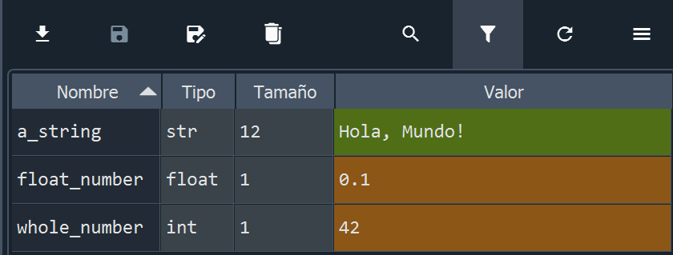
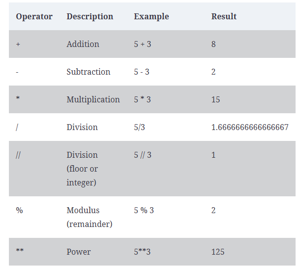
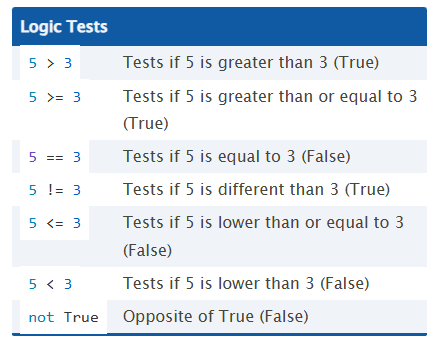
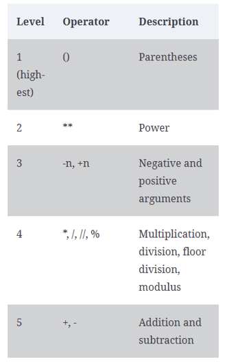
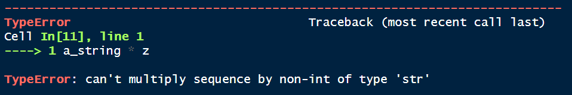
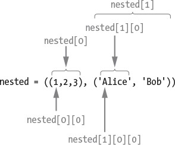
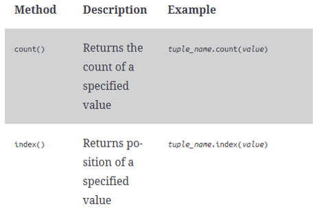
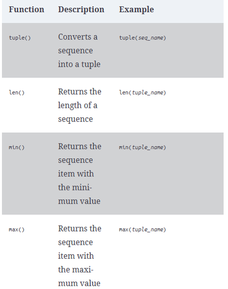
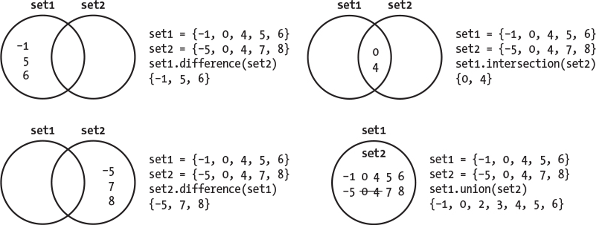

+-----------------------------------------------------------+-----------------------------:+
| **Fundamentos de Programación TIG**<br>                   |  |
| Máster en Tecnologías de la Información Geográfica (TIG)\ |                              |
| Universidad de Alcalá                                     |                              |
+-----------------------------------------------------------+------------------------------+

------------------------------------------------------------------------

<br> <br>

Ahora que dominas lo básico de Spyder, crea un nuevo proyecto para empezar a programar. A lo largo de este tutorial verás varios ejemplos prácticos sobre tipos de datos y contenedores, que son las estructuras más simples de Python. Te animo a que los escribas y ejecutes por tu cuenta mientras lees. Para ello, usa el **Editor** si quieres guardar tus scripts para el futuro, o la **Consola** ("Terminal") si solo quieres hacer pruebas rápidas.

<br>

## Tipos de datos

### Tipos de datos básicos y conversiones

Al programar, necesitamos trabajar con distinta clase de información: desde hacer cálculos hasta procesar texto. Al igual que en R, en Python distinguimos entre varios tipos de datos básicos:

-   **Integer**: números enteros (5).
-   **Float**: números decimales (0.1). Es importante usar siempre el punto como separador de decimales.
-   **String**: cadenas de texto ("Hola Mundo").
-   **Bool (booleano)**: valores lógicos (`True` o `False`).

En Python, la asignación de un valor (sea numérico o string) se realiza con el símbolo "=" (a diferencia de R, donde la asinación se realiza con flechas "\<-"). La asignación actúa como una "etiqueta" que asiste al acceso de la información en la memoria.

A continuación, se muestran ejemplos de varias asignaciones en Python.

```{python}
# INTEGER:
whole_number = 42

# FLOATS:
float_number = 0.1

# STRING:
a_string = "Hola, Mundo!"
```

<br>

En el código anterior, observa cómo las almohadillas (#) también sirven para comentar fragmentos de código.

Oberva como en Spyder también se crean variables en nuestro entorno, al igual que en RStudio. En este caso, Spyder usa un código de colores para distinguir entre varios tipos.



<br>

La función `type` nos ayuda a identificar el tipo de dato de un objeto en Python.

```{python}
type(a_string)
```

<br>

Existen también otras funciones que nos permiten convertir un objeto a distintos tipos de datos.

```{python}
x = float(whole_number)
y = int(0.1)
z = str(whole_number)
s = bool(y) # La función bool() nos ayuda a convertir un valor en booleano
s = bool(a_string) # Podemos sobrescribir valores tantas veces como queramos
s = bool(x)
```

<br>

La función `round` también nos permite redondear un número.

```{python}
a = 5.5689
a1 = round(a, 2) # Redondear a dos posiciones decimales
a2 = round(a) # Redondear a número entero
```

<br>

### Operaciones matemáticas y lógicas

También es posible utilizar Python como calculadora. En la figura 2 puedes encontrar algunos ejemplos de los principales operadores matemáticos soportados en Python.

{#fig-02_001 fig-cap="Principales operadores matemáticos en Python." fig-align="center" width="50%"} <br>

```{python}
print(5 + 3) # Es posible usar Python como calculadora

x - float_number # También con variables con valores definidos
```

<br>

Fíjate cómo en el ejemplo anterior, Python recuerda que "x" es un valor numérico, creado mediante la asignación al objeto "whole_number", que tenía un valor de 42.

También es posible hacer test de lógica en Python.

{#fig-02_002 fig-cap="Principales operadores lógicos en Python." fig-align="center" width="50%"} <br>

```{python}
# Haciendo test de lógica en Python:
print(y > x) # Comprueba si un valor es mayor que otro
print(y >= x)
print(y == float_number)  # Para comprobar si un valor es exactamente igual a otro
print(y != float_number)  # O si por el contrario son distintos
```

<br>

Python también nos permite resolver fórmulas matemáticas complejas.

```{python}
10**2 + (6 - 2) / 2 * 3
```

<br>

Observa el resultado de la fómula anterior. Es importante siempre recordar la jerarquía de las operaciones matemáticas.

{#fig-02_003 fig-cap="Precedencia matemática." fig-align="center" width="30%"} <br>

### Asignaciones aumentadas

Python también nos permite hacer asignaciones aumentadas. Observa el siguente código y fíjate en cómo cambian los valores de "x".

```{python}
x = 5
print(x)
x = x + 5
print(x)
```

<br>

Incluso añadiendo los signos de operaciones matemáticas al símbolo de asignación.

```{python}
x += 5
print(x)
```

<br>

También es posible hacer operaciones de asignación aumentada sobre strings. En estos casos lo que sucederá será una concatenación de los valores.

```{python}
print(a_string + " " + z)

z *=2 #También se pueden hacer asignaciones aumentadas con strings.
print(z)
```

<br>

No obstante, hay algunos casos de operaciones matemáticas que necesitan interacción con variables `integer`. Trata de ejecutar la siguiente secuencia y observa el error que genera.

```{python}
#| eval: false
a_string * z
```

<br>

{#fig-02_004 fig-cap="Ejemplo de TypeError." fig-align="center" width="50%"}

<br>

### Módulo "math" en Python

La biblioteca estándar de Python incluye un módulo `math` que proporciona funciones para realizar operaciones matemáticas más específicas, como trabajar con factoriales, ecuaciónes cuadráticas, funciones trigonométricas, exponenciales, hiperbólicas, etc. Como seguramente recordarás de la parte de R de la asignatura, las funciones son como miniprogramas que realizan una o varias tareas. Ocultan los detalles de estos programas para que puedas escribir un código más limpio.

Para usar una función, escribe el nombre de la función seguido de paréntesis. Los valores o variables que introduzcas dentro de los paréntesis servirán como datos de entrada para la función. Más adelante, aprenderemos a definir funciones en Python.

Los grupos de funciones relacionadas con una misma temática o propósito suelen reunirse en módulos. Un módulo, no es más que un archivo `.py` con funciones, clases y variables que se pueden importar como en otro archivo como código.

Para usar el módulo `math`, primero debes importarlo mediante el comando `import`. El siguiente fragmento de código, muestra las principales funciones dentro del módulo `math`.

```{python}
#| eval: false

ceil(x) #Returns the smallest integer greater than or equal to x

fabs(x) #Returns the absolute value of x as a floating-point number

factorial(x) #Returns the factorial of x

floor(x) #Returns the largest integer less than or equal to x

frexp(x) #Returns the mantissa and exponent of x as the pair (m, e)

isnan(x) #Returns True if x is a NaN (Not a Number)

exp(x) #Returns e**x

log(x[, b]) #Returns the logarithm of x to the base b (defaults to e)

log2(x) #Returns the base-2 logarithm of x

log10(x) #Returns the base-10 logarithm of x

pow(x, y) #Returns x raised to the power y

sqrt(x) #Returns the square root of x

acos(x) #Returns the arc cosine of x

asin(x) #Returns the arc sine of x

atan(x) #Returns the arc tangent of x

atan2(y, x) #Returns the arc tangent of y / x

cos(x) #Returns the cosine of x

hypot(x, y) #Returns the Euclidean norm, sqrt(x**2 + y**2)

sin(x) #Returns the sine of x

tan(x) #Returns the tangent of x

degrees(x) #Converts x from radians to degrees

radians(x) #Converts x from degrees to radians
```

<br>

Observa el uso de algunas funciones anteriores en el siguiente código.

```{python}
import math

x = math.radians(45)
print(x)

math.cos(x)
```

<br>

En el código anterior, para usar las funciones de `math`, primero debemos importar el módulo. Después, para llamar a cada funcion (`radians` o `cos` en este caso) debemos indicar el nombre del módulo seguido de un punto para llamar a la función (`math.radians`). Esta es la manera en la que le decimos a Python que use la función `radians` dentro del módulo `math`. Piensa que en Python la "notacion de punto" funciona de forma similar al genitivo sajón en inglés (`math.radians` = *math's radians function*). Esta es una de las principales diferencias de escritura de código entre R y Python. Mientras que en Python la norma es indicar el nombre del módulo de pertenencia de la función, en R la norma es NO indicarlo. Por otro lado, en R el uso del punto (.) es sólo un carácter más y no indica pertenencia (a pesar de que se use en algunas funciones, por ejemplo `read.csv`). Cuando en R realmente se necesita especificar el paquete por algún conflicto de nombres, se utilizan los dos puntos dobles `::` en lugar del punto.

<br>

### Trabajo con strings en Python

Más allá de la concatenación (+) y la repetición (\*) asistida con algunos operadores matemáticos como hemos visto antes, los strings (cadenas de texto) soportan diversas operaciones de secuencia. Entre las más habituales se encuentran el *slicing* (extracción de subcadenas mediante `índices`) y las *pruebas de pertenencia*. Veamos algunos ejemplos prácticos de ambas.

<br>

#### Indexación y *String slicing*

A veces, extraer caracteres individuales o dividir cadenas de texto (palabras o frases) son las tareas más habituales al trabajar con un objeto string. En Python podemos utilizar los corchetes `[]` para acceder a un carácter concreto según su posición. Como probablemente recordarás de R, esta operación recibe el nombre de **indexación**. <br>

::: callout-warning
**¡Atención! Cuidado con la numeración en la indexación**

A diferencia de R, Python empieza a contar desde 0. Por ello, el primer elemento de una cadena será siempre el 0 en lugar del 1.
:::

<br>

Veamos un ejemplo de indexación:

```{python}
x = 'PYTHON' # Creamos un string
print(x[0]) # Extraemos el primer elemento

print(x[5]) # Extraemos el sexto elemento

# El código también funciona sin usar la función print, pero esta función asegura que todos los resultados se impriman y se muestren
```

<br>

Usando dos puntos `:`dentro de los corchetes `[]` podemos extraer trozos de la cadena de caracteres. Esto es lo que llamamos *string slicing*.

A continuación se muestran algunos ejemplos:

```{python}
print(x[:3])
print(x[0:3]) # Básicamente, lo mismo que lo anterior.
print(x[2:])
```

<br>

La numeración que se incluye a cada lado de los dos puntos `:`dentro de un corchete `[]` se lee de la siguiente forma: `[inicio : fin]`. Si no se indica nada a la izquierda de los dos puntos, se entiende que el inicio es el primer elemento (la P en PYTHON). Si no se indica nada a la derecha de los dos puntos, se entiende que el final es el último elemento (la N en PYTHON).

Exploremos ahora el funcionamiento de los dos puntos más en profundidad con algunos ejemplos:

```{python}
# Ejemplo 1:
print(x[2:5])

# Ejemplo 2:
print(x[0:5:2])
```

<br>

Analicemos los resultados en profundidad. El objeto `x` se corresponde con la palabra PYTHON cuyos índices se corresponden de la siguiente manera:<br> 
P Y T H O N <br> 
0 1 2 3 4 5 <br>

En el ejemplo 1, vemos que el resultado ha sido "THO". La letra "T" se corresponde con el índice 2, indicando que el inicio es justamente el índice 2, incluyendo esa letra. No obstante, la instrucción indica el fin en el índice 5, pero la última letra reportada ha sido la letra "O" que se corresponde con el índice 4. Esto quiere decir que cuando se trata de indicar el final de la cadena, Python nunca incluye el valor al que hace referencia. En un símil matemático, los índices en Python sería como usar la siguiente estructura para un intervalo: `[valor1, valor2)`. El corchete `[` inicial indica que el primer valor si se incluye, y el paréntesis `)` final representa que el último valor no está incluido.

Veamos ahora el resultado del segundo ejemplo. Cuando tenemos una estructura con tres términos dentro del corchete `[término1:término2:término3]`, cada término debe interpretarse de la siguiente manera: `[inicio:fin:paso]`. Es decir, como muestra el resultado "PTO", la cadena empieza en el primer elemento (índice 0), termina justo antes del sexto elemento (índice 5, que no se incluye) y avanza de 2 en 2 posiciones (dejando 1 elemento sin coger entre cada selección). Así, se incluye el primer elemento "P", se salta "Y" para incluir "T", y se salta "H" para incluir "O".

<br>

::: callout-note
**Minirreto 1**. Descifrando operaciones de string slicing.

Ahora que ya sabemos cómo funciona el *string slicing* en Python, siendo `x = 'PYTHON'`, ¿sabrías explicar los resultados de las siguientes operaciones?

Operación 1: x\[-1\]

Operación 2: x\[-3\]

Operación 3: x\[::-1\]
:::

<small>Nota: podrás descifrar el resultado de estas operaciones en el test 2.1. de este tema.</small>

<br>


#### Operaciones de pertenencia

Muchas veces necesitamos simplemente consultar si un caracter o una palabra se encuentra dentro de una cadena. Estas consultas simples se pueden realizar con los operadores `in` y `not in`.

```{python}
print('e' in 'scientist')

print('engineer' not in 'I am a scientist')

#Podemos obviar escribir la función print
```

<br>

No obstante, para consultas masivas o más complejas, Python incorpora de forma nativa los siguientes métodos para trabajar con strings:

```{python}
#| eval: false

str.capitalize() #Capitalizes the first character with the rest lowercase

str.count(sub, start, end) #Counts occurrences of a character or substring

str.endswith(suffix, start, end) #Returns True if string ends with the suffix

str.find(sub, start, end) #Returns lowest index where substring is found within slice

str.isalnum() #Returns True if all string characters are alphanumeric

str.isalpha() #Returns True if all string characters are alphabetic

str.isdigit() #Returns True if all string characters are digits

str.islower() #Returns True if all string characters are lowercase

str.isupper() #Returns True if all string characters are uppercase

str.lower() #Changes all cased characters to lowercase

str.replace(old, new, count) #Replace old substring with new substring

str.split(sep=None, maxsplit=-1) #Return list of words with “sep” character as the delimiter

str.startswith(prefix, start, end) #Return True if string starts with the prefix

str.strip(chars) #Removes leading and trailing characters; removes whitespace if no character is specified

str.title() #Capitalizes the first character in each word

str.upper() #Changes all cased characters to uppercase
```

<br>

A continuación, podemos probar alguno de estos métodos.

```{python}
# Algunos métodos básicos con strings:
print(str.capitalize(a_string)) # Pone en mayúsculas la primera letra
print(str.upper(a_string)) # Convierte todo en mayúsculas

# También pueden separarse caracteres:
brutus_said = 'Ave, Cesar.'
words = brutus_said.split()
print(words)
```

<br>

Seguramente te estarás preguntando por qué a estos comandos les llamamos **métodos** y no funciones, si parecen lo mismo. Al igual que hemos visto con el módulo `math` se escriben siguiendo la "notación de punto" pero su significado no es el mismo. Todo depende de lo que haya a la izquierda del punto (.). Si lo que hay a la izquierda del punto es un "paquete" o un módulo, el comando que aparece a la derecha del punto es una función, como ocurría cuando explicabamos las funcionalidades del módulo `math`. No obstante, si lo que hay a la izquierda del punto es un objeto, sobre el cual operamos una acción (por ejemplo `brutus_said.split()`), lo que hay a la derecha se le llama método.

<br>

::: callout-important
**Métodos vs Funciones** 

En Python, los objetos suelen tener sus propias "capacidades" integradas (llamadas **métodos**). Por ejemplo, un objeto de tipo string como brutus_said puede ejecutar brutus_said.split() para devolver una lista con sus palabras separadas (creando un objeto nuevo, sin modificar el texto, objeto, original).

Esto supone una diferencia visual importante respecto a la forma de escribir código en R, donde lo habitual es pasar el dato dentro de una función (funcion(objeto), como `strsplit(brutus_said, " ")`), mientras que en Python se suele usar la notación de punto (objeto.metodo()).

Esta manera de trabajar forma parte de la **Programación Orientada a Objetos (POO)**, un paradigma en el que los propios objetos son los protagonistas y contienen sus propias acciones, en contraste con enfoques más funcionales (Progamación Funcional) o procedimentales (Programación Procedimental) donde funciones externas operan sobre los datos. Puedes revisitar los apuntes 1.1. en el Tema 1 para refrescar algunos conceptos.
:::

<br>

## Tipos de contenedores

Además de los tipos de datos descritos anteriormente, en Python podemos trabajar con diferentes estructuras o contenedores de datos. En este sentido, podemos distinguir entre 4 contenedores de datos básicos: 1) tuplas, 2) listas, 3) sets y 4) diccionarios.

Veamos la definición y características de cada uno de ellos.

<br>

### Tuplas

Las tuplas son una secuencia de valores ordenada, iterable, con una longitud fija e **inmutables**. Pueden contener valores heterogéneos como números enteros (`int`), decimales (`float`) o cadenas de caracteres (`str`). Para crear una tupla, basta con listar los valores dentro de un paréntesis:

```{python}
tupla = (1, 2, 3) # Tupla simple
t2 = (1, (2, 3), (4, 5, (6, 7))) # Tupla anidada
```

<br>

Observa como al ejecutar el fragmento de código anterior aparecen dos nuevos objetos en el explorador de variables. El objeto `tupla` tiene 3 elementos, todos ellos de tipo `int`. El objeto `t2` es una tupla anidada. También tiene 3 elementos pero en este caso, el primero es un número entero y los otros dos son tuplas en sí mismas. Fíjate que Spyder permite abrir la tupla para inspeccionar los valores haciendo doble clic sobre el nombre del objeto en el explorador de variables.

Los elementos de una tupla también pueden asignarse a objetos individuales:

```{python}
x, y, z = t2 # Desempaquetar tupla t2
```

<br>

Mira como el código anterior crea tres nuevos objetos, (`x`, `y`, `z`), cada uno albergando los elementos de la tupla `t2`. A este proceso se le llama `unpack` (desempaquetar).

También podemos convertir un objeto en tupla con la función `tuple()`.

```{python}
x = tuple("Hello, World!") # Función para convertir un objeto a tupla
```

<br>

La indexación mediante el uso de los corchetes (`[]`) que hemos visto en el epígrafe "Trabajo con strings" también funciona con estas estructuras de datos. Presta atención al siguiente fragmento de código e interpreta qué elementos se extraen en cada caso.

```{python}
print(tupla)
print(tupla[1])
print(tupla[2])
```

<br>

Recuerda que Python empieza a contar desde 0, por lo que el elemento `[1]` en el objeto `tupla` es en realidad el segundo elemento (2).

En caso de trabajar con tuplas anidadas, debemos indicar corchetes sucesivos (`[][]`) para indicar claramente los valores a los que hacemos referencia dentro de cada tupla. La siguiente figura explica de forma gráfica la sintaxis. Fíjate que el *uso de los paréntesis* es importante para distinguir entre los elementos de una tupla.

{#fig-02_006 fig-cap="Sintaxis para extraer índices en una tupla anidada." fig-align="center" width="50%"} <br>

Atendiendo a la figura anterior, veamos un ejemplo de indexacion aplicado a nuestra tupla anidada `t2`. Observa y analiza los resultados.

```{python}
# Muestra la tupla
print(t2)

# Indexación 1
print(t2[1])

# Indexación 2
print(t2[2][2])

# Indexación 3
print(t2[2][2][0])
```

Los objetos tipo tupla pueden usar los métodos y funciones presentadas en las siguientes figuras.

{#fig-02_007 fig-cap="Métodos básicos para usar en tuplas." fig-align="center" width="40%"} <br>

{#fig-02_008 fig-cap="Funciones básicas para usar en tuplas." fig-align="center" width="40%"} 

<br>

### Listas

Las listas son una secuencia ordenada, iterable, de longitud variable y **mutable** de valores. Son objetos similares a las tuplas, pero **mutables** (retén esta idea, pues en el epígrafe "Explorando la identidad de los objetos en Python" veremos qué es esto de objetos mutables e inmutables).

Para crear una lista se deben utilizar los corchetes `[]`, a diferencia de las tuplas que usan los paréntesis `()`.

```{python}
# Creando una lista:
dna_bases = ['adenosine', 'guanine', 'cytosine', 'thimidine']

dna_bases
```

<br>

En las listas, los corchetes también sirven para hacer indexaciones y acceder a elementos concretos del objeto.

```{python}
dna_bases[0]
```

<br>

A continuación, se muestran los métodos que funcionan con objetos tipo lista.

```{python}
#| eval: false

append() #Add a single item to the end of a list --> list_name.append(item)

extend() #Add iterable items to the end of a list --> list_name.extend(iterable)

insert() #Insert an item before a given index (i) --> list_name.insert(i, item)

remove() #Remove first item from list with value = item -->list_name.remove(item)

pop() #Remove and return item at given index --> list_name.pop(index)

clear() #Remove all items from a list --> list_name.clear()

index() #Return index of first item with value = item --> list_name.index(item)

count() #Return number of times an item appears in a list --> list_name.count(item)

sort() #Sort list items in place -->list_name.sort()

reverse() #Reverse list items in place --> list_name.reverse()

copy() #Return a shallow copy of a list --> list_name.copy()
```

<br>

Date cuenta que al ser objetos mutables, las listas tienen más métodos que las tuplas. Que un objeto sea mutable significa que lo podemos editar. Por ejemplo, añadiendo nuevos valores a la lista (`append`), reordenándolos (`sort`) o borrando entradas (`remove`, `pop`). Practiquemos con algunos ejemplos.

```{python}
lista = ['manzana', 'pera', 'melocotón'] 
print("Resultado de lista:", lista)

lista.append('naranja') # Función para añadir elementos a una lista
print("Resultado de lista.append:", lista)

fruta_fav = lista.pop(3) # Extrae un elemento y lo asigna a una variable nueva
print("Resultado de fruta_fav:", fruta_fav) # El elemento ha sido "cortado y pegado"

lista.sort() # Al ser mutables, las listas pueden ordenarse alfabéticamente
print("Resultado de lista.sort alfabético:", lista)

lista.sort(key=len) # Incluso, los criterios para ordenase pueden variar
print("Resultado de lista.sort por longitud:", lista)

lista.remove('pera') # Borrar elemento por valor exacto 
print("Resultado de lista.remove por valor exacto:", lista)

lista.pop(0) # Borrar elemento por índice (posición 0)
print("Resultado de lista.pop por índice:", lista)
```

<br>

::: callout-tip
**Diferencia entre append() y extend()**

La diferencia principal es que append() añade el elemento completo al final como una sola unidad, mientras que extend() recorre un iterable (como otra lista) y añade sus elementos uno por uno.

```{python}
a = [1, 2]
a.append([3, 4])
print(a)  # Resultado: [1, 2, [3, 4]] -> Añadió la lista entera dentro de la otra (lista anidada)

b = [1, 2]
b.extend([3, 4])
print(b)  # Resultado: [1, 2, 3, 4]   -> Unió los elementos individuales

```

Que un objeto sea iterable quiere decir que podemos recorrer sus elementos uno por uno. Esto significa que podemos pasarle funciones o métodos como `extend()` o utilizar bucles `for`, como veremos en el Tema 3. Tanto las listas como las tuplas, son elementos iterables.
:::

<br>

::: callout-note
**Minirreto 2**. Listas en R y Python: ¿son lo mismo?

1. Crea una lista `x` en Python que contenga los valores 10, 20, 30 y 40.

2. Crea esa misma lista `x`en R. Compara la sintaxis entre ambos lenguajes.

3. Ejecuta los siguientes bloques de código en R y Python. Interpreta los resultados.

```{python}
#| eval: false

# código en R:
x[1]
x[[1]]
x[2:3]
```


```{python}
#| eval: false

# Código en Python:
x[1]
x[0]
x[1:3]
```

4. Añade un elemento nuevo con valor "50" a la lista `x`. ¿Qué sintaxis usarías en R? ¿Y en Python? Compáralas.

5. Ejecuta los siguientes bloques de código en R y Python. ¿Qué resultado produce cada operación? ¿Multiplicar una lista por 2 significa lo mismo en ambos lenguajes?

```{python}
#| eval: false

# Código en R:
x <- list(10, 20, 30)
x * 2
```


```{python}
#| eval: false

# Código en Python:
x = [10, 20, 30]
x * 2
```

6. Modifica el segundo elemento de la lista por el valor "100". ¿Qué código usarías en R? ¿Y en Python?

:::
<small>Nota: podrás descifrar el resultado de estas operaciones en el test 2.1. de este tema.</small>

<br>


### Sets

Los sets son una colección de valores con las siguientes características:

-   son valores únicos: no admite duplicados.

-   desordenados: no son accesibles a través de índices (`[]`).

-   iterable.

-   **mutable**.

Para crear sets, utilizamos llaves (`{}`).

```{python}
# Creando un set numérico:
s = {1, 2, 3}
print(s)

# Creando otro set:
frutas = {'platano', 'kiwi', 'albaricoque'}
print(frutas)
```

<br>

Observa como al crear el set de `frutas` los valores se muestran en otro orden diferente al que hemos introducido. Automáticamente Python ordena los elementos de menor a mayor según su longitud. En este caso, número de caracteres.

```{python}
# La indexación en los set no se hace por posición, sino por pertenencia:
print(1 in s)   # True
print(45 in s)      # False
```

<br>

Aunque los objetos tipo `set` ocupan mucha memoria (más que las listas y las tuplas), son muy eficientes para identificar duplicados o elementos que se repiten en varios sets. De hecho, los set tienen un conjunto de métodos muy útiles para este tipo de operaciones. Observa algunos ejemplos en la siguiente figura.

{#fig-02_009 fig-cap="Operaciones frecuentes de comparación entre sets." fig-align="center" width="70%"}

<br>

Aquí tienes algunos de los métodos más frecuentes con sets:

```{python}
#| eval: false

set1.add(item) #Add item to set

set1.clear() #Reset to empty

set1.copy() #Returns a shallow copy of a set

set1.difference(set2) #Return unshared items

set1.difference_update(set2) #Set set1 to items not in set2

set1.discard(item) #Removes selected item from a set

set1.intersection(set2) #Return all items in both sets

set1.intersection_update(set2) #Set set1 to intersecting items

set1.isdisjoint(set2) #Return True if no shared items

set1.issubset(set2) #Return True if set2 contains set1

set1.issuperset(set2) #Return True if set1 contains set2

set_name.pop() #Remove arbitrary element from a set

set_name.remove(item) #Remove an item from a set

set1.symmetric_difference(set2) #Return unshared set1 and set2 items

set1.symmetric_difference_update(set2) #Set set1 to unshared items

set1.union(set2) #Return all unique items in both

set1.update(set2) #Set set1 to unique set1 and set2 items
```

<br>


### Diccionarios

Los diccionarios son una colección de valores ordenados, iterables y **mutables** que están indexados por "claves" en lugar de por posición.

Para crear un diccionario, al igual que los sets, usamos las llaves `{}`. La diferencia es que para crear un diccionario, cada elemento debe estar compuesto por una pareja de una "clave" y un "valor" siguiendo la forma `'clave': 'valor'`. También podemos utilizar la función `dict()` para crear un diccionario. Observa el siguiente código:

```{python}
# Creando dos diccionarios similares con distintos métodos:
dict1 = {'bread': 'good', 'fire': 'bad', 'exam': 'very bad'}
print(dict1)
dict2 = dict(bread='good', fire='bad', exam='very bad')
print(dict2)
```

<br>

Esta forma de codificar los elementos, nos permite extraer todos los valores o todas las claves con los métodos `values()`y `keys()`, o ambas cosas por parejas con `items()`. También podemos extraer valores concretos por su nombre:

```{python}
dict1.values()
dict1.keys()
dict1.items()
dict1['exam']
```
<br>

Esta forma de indexar la información es útil para crear tuplas, listas o sets de valores sobre los que operar.

El siguiente fragmento de código muestra otros métodos de uso común en objetos tipo diccionario:

```{python}
#| eval: false

clear() #Remove all dictionary elements

copy() #Return a copy of a dictionary

fromkeys() #Return a dictionary with the specified keys and a value

get() #Return the value of a specified key

items() #Return a tuple of all key-value pairs

keys() #Return a list of a dictionary’s keys

pop() #Remove the element with specified key

popitem() #Remove the last inserted key-value pair

setdefault() #Insert specified key and value if no key, else return value if key exists

update() #Update dictionary with specified key-value

values() #Return a list of the values in a dictionary
```

<br>

Entre los métodos anteriores, uno de los más usados es `update()` que permite añadir nuevas entradas a nuestro diccionario.

```{python}
dict1.update({'my_dog': 'excelent'})
print(dict1)
```

<br>

Resulta interesante también la funcionalidad del operador `**` para combinar varios diccionarios. Echa un vistazo al siguiente código:

```{python}
d1 = dict(Harry='good', Draco='bad')
d2 = dict(Hermione='good', Tom='bad')
d3 = dict(Ron='good', Dolores='bad')
d4 = {**d1, **d2, **d3}
print(d4)
```

<br>

Con estas notas hemos repasado los conceptos fundamentales sobre los tipos de datos y las principales estructuras (o contenedores) de datos de Python. La siguiente tabla sintetiza las características más importantes que tienes que saber de cada una y permite comparar sus principales diferencias:

+-----------+----------------------+-------------+------------------------------------------------------------+-------------------------+
| Tipo      | Estructura de datos  | Mutabilidad | Características principales                                | Ejemplo                 |
+===========+======================+=============+============================================================+=========================+
| Secuencia | Tupla (`tuple`)      | Inmutable   | Rápida, eficiente y no modificable                         | `(2, 5, 'Pluto', 4.56)` |
+-----------+----------------------+-------------+------------------------------------------------------------+-------------------------+
| Secuencia | Lista (`list`)       | Mutable     | Flexible y con numerosas funciones integradas              | `[2, 5, 'Pluto', 4.56]` |
+-----------+----------------------+-------------+------------------------------------------------------------+-------------------------+
| Conjunto  | Conjunto (`set`)     | Mutable     | No admite elementos duplicados y permite búsquedas rápidas | `{2, 5, 'Pluto', 4.56}` |
+-----------+----------------------+-------------+------------------------------------------------------------+-------------------------+
| Mapeo     | Diccionario (`dict`) | Mutable     | Asocia claves únicas con valores                           | `{'key': 'value'}`      |
+-----------+----------------------+-------------+------------------------------------------------------------+-------------------------+

<br>

Recuerda que puedes profundizar en estos tipos de datos y estructuras de datos consultando la bibliografía y los recursos recomendados en la asignatura. En particular, los capítulos 7 y 9 del libro [_Python tools for scientist_](https://learning.oreilly.com/library/view/python-tools-for/9781098156688) de Lee Vaughan (2023) puede resultar de utilidad para profundizar conocimientos.

<br>

::: callout-note
**Minirreto 3**. Operaciones de acceso y manipulación de estructuras de datos.

Observa las siguientes estructuras de datos:

```{python}
x = (10, 20, 30, 40, 50)

y = ("Madrid", (28001, 28002, 28003), "España")

z = ["Python", "R", "QGIS", "ArcGIS", "GeoPandas"]

w = {10, 20, 30, 40, 50}

v = {
    "nombre": "Madrid",
    "poblacion": 3420000,
    "superficie": 604.45,
    "provincias_vecinas": ["Toledo", "Guadalajara", "Segovia"]
}
```

**¿Qué resultados obtendríamos de las siguientes operaciones?** Antes de ejecutar el código, intenta razonar qué devuelve cada expresión y si alguna produce un error.


Operación 1: x[-2]

Operación 2: x[1:4]

Operación 3: y[1][0]

Operación 4: z[::-1]

Operación 5: z[1:4:2]

Operación 6: w[0]

Operación 7: w[10]

Operación 8: v["nombre"]

Operación 9: v["provincias_vecinas"][1]

Operación 10: v.get("densidad")

:::

<small>Nota: podrás descifrar el resultado de estas operaciones en el test 2.1 de este tema.</small>

<br>


## Explorando la identidad de los objetos en Python

Para terminar este primer notebook del tema 2, exploremos un poco más sobre cómo Python almacena la información con la que trabajamos. Al llegar hasta aquí, te habrás dado cuenta que Python encapsula los datos y los métodos que pueden operar sobre ellos en entidades nombrables conocidas como **objetos**. Todo en Python es un `objeto`, y cada `objeto` tiene una identidad, un tipo (`int`, `float`, `str`, etc.) y un valor. La identidad es un código que apunta a un espacio en la *memoria* del ordenador en el que se almacena la información. Así, el número 42 es un objeto al igual que la frase "Hola Mundo!", cada uno de ellos con una identidad diferente. La identidad de un objeto y su tipo nunca cambian, pero su valor, como sabemos, a veces puede cambiar.

Cuando realizamos una asignación en Python, por ejemplo `x = 5`, en realidad lo que hacemos es iniciar una variable a un objeto `x`, al que también le estamos otorgando una identidad. Este objeto es único entre todos los objetos existentes en el entorno. El comando `id` nos permite acceder y consultar esta identidad.

```{python}
x = 5

id(x)
```

<br>

Los objetos tipo tupla, lista, set o diccionario también tienen su propia identidad.

```{python}
tupla = (5, 'manzana', 33)
print("tupla id:", id(tupla))

lista = (22, 15, 7)
print("lista id:", id(lista))
```

<br>

Ahora hagamos un pequeño ejercicio.

::: callout-note
**Ejercicio**. Descubriendo la identidad de los objetos en Python.

1.  Crea una variable x con un valor numérico determinado.
2.  Asigna x a otra variable y (copia el valor de x en otra variable).
3.  Comprueba la identidad de los objetos x e y. ¿Ambos objetos tienen la misma identidad?
4.  Ahora reasigna x a otro valor numérico diferente.
5.  Vuelve a comprobar la identidad de x. ¿Ha cambiado la identidad de x con respecto a la original?
6.  Ahora comprueba el valor de y. Comprueba también su identidad. ¿Ha habido cambios en y?
:::

<br>

Ejemplo de solución:

```{python}
# 1. Crea una variable x con un valor numérico determinado.
x = 5
print("x=", x)

# 2. Asigna x a otra variable y (copia el valor de x en otra variable).
y = x
print("y=", y)

# 3. comprueba la identidad de los objetos x e y.
print("Identidad de x:", id(x))
print("Identidad de y:",id(y))

# 4. Ahora reasigna x a otro valor numérico diferente.
x = 3
print("x=", x, "--> nuevo valor de x")

# 5. Vuelve a comprobar la identidad de x.
print(id(x), "--> nueva identidad de x") # Si, ha cambiado la identidad.

# Ahora comprueba el valor e identidad de y.
print("Valor de y:", y, "; Identidad de y:", id(y)) # No, no ha habido cambios en y ni en su identidad.

```

<br>

En este ejericio, acabamos de descubrir lo que en programación se llama **Aliasing**. Ocurre cuando dos variables (x e y) apuntan al mismo objeto en la memoria de nuestro ordenador. Al definir la variable `y` con el mismo valor que `x` Python interpreta que ambos objetos son el mismo. De este modo, las **variables** pueden ser definidas como una etiqueta concreta para un objeto. Al igual que las personas pueden tener múltiples etiquetas (nombres, formales, informales, motes, etc.), un objeto en Python también puede ser conocido por múltiples variables (x e y, en este caso hasta el paso 3 de nuestro ejercicio). Esta forma de trabajar en Python es una ventaja porque permite ahorrar espacio en la memoria del ordenador.

<br>

::: callout-tip
**Diferencia entre objeto y variable**

Revisita los contenidos del Tema 1, donde hablábamos de las diferencias entre "objeto" y "variable", ejemplificado en el caso de Fran (objeto), una persona (clase) que tomaba diferentes nombres (variables) en función de la situación (su nombre en el DNI, su mote en el trabajo, y el apelativo cariñoso de su pareja). En el ejemplo anterior, el mismo objeto (5) podía tomar variables (nombres) diferentes (x o y).
:::

<br>

Si no estamos seguros de que dos objetos son el mismo, podemos utilizar los operadores `==` o `is`.

```{python}
a  = 6 

b = 6 

a == b

id(a)
id(b)
```

<br>

Tenemos que tener en cuenta que en el ejercicio anterior hemos trabajado con objetos tipo `int`, que son objetos **inmutables**. Pero, ¿qué pasaría si trabajásemos con un objeto **mutable**, como una lista, un set o un diccionario? Hagamos la prueba.

<br>

::: callout-note
**Ejercicio**. Descubriendo la identidad de los objetos en Python II: aliasing y objetos mutables.

1.  Crea una lista "a" con una serie de valores determinados.
2.  Asigna "a" a otra lista "b".
3.  Comprueba la identidad de los objetos "a" y "b". ¿Ambos objetos tienen la misma identidad?
4.  Modifica la lista "b" añadiendo un nuevo elemento utilizando el método `append`.
5.  Ahora imprime los valores de "a" y "b" y comprueba la identidad de ambos objetos. ¿Ha cambiado algo?
:::

<br>

Ejemplo de solución:

```{python}
# 1. Crea una lista "a" con una serie de valores determinados..
a = [7, 5, 9]
print("a=", a)

# 2. Asigna "a" a otra lista "b".
b = a
print("b=", b)

# 3.Comprueba la identidad de los objetos "a" y "b".
print("Identidad de a:", id(a))
print("Identidad de b:",id(b))

# 4. Modifica la lista "b" añadiendo un nuevo elemento utilizando el método `append`.
b.append(3)


# 5. Ahora imprime los valores de "a" y "b" y comprueba la identidad de ambos objetos.
print("b=", b, "--> lista b actualizada con append")
print("a=", a, "--> lista a") # Ojo, también ha cambiado al cambiar b!

print(id(a), "--> identidad de a") 
print(id(b), "--> identidad de b") # No ha cambiado la identidad!

```

<br>

Este segundo ejercicio demuestra que si tenemos dos variables (a y b) que apuntan al mismo objeto, y ese objeto es mutable (una lista, un set o un diccionario), al cambiar el valor de una variable (a) se cambia también indirectamente el valor de la variable (b). Es por ello, por lo que debemos tener cuidado con el **Aliasing** en objetos mutables.

La siguiente tabla puede ayudarte a recordar cuáles son los objetos mutables en Python:

+--------------------------------+------------+--------------------------------------------------------------------------------------------------------------+
| Tipo                           | ¿Mutable?  | ¿Es posible el aliasing?                                                                                     |
+================================+============+==============================================================================================================+
| `list`, `dict`, `set`          | Sí         | Sí. Dos variables pueden apuntar al mismo objeto y los cambios realizados a través de una afectan a la otra. |
+--------------------------------+------------+--------------------------------------------------------------------------------------------------------------+
| `int`, `float`, `str`, `tuple` | No         | No de forma directa: los objetos son inmutables, por lo que no pueden modificarse.                           |
+--------------------------------+------------+--------------------------------------------------------------------------------------------------------------+

<br>

Para evitar el problema del **Aliasing** con objetos mutables debemos **clonar** el objeto ("shallow copy", en inglés), no sólo asignarlo. Para ello, podemos usar el método `copy()`, presentado anteriormente como uno de los métodos posibles para listas, sets y diccionarios.

<br>

::: callout-note
**Ejercicio**. Descubriendo la identidad de los objetos en Python III: clonando objetos.

1.  Crea una lista "a" con una serie de valores determinados.
2.  Clona "a" a otra lista "b" usando `copy`.
3.  Comprueba la identidad de los objetos "a" y "b". ¿Ambos objetos tienen la misma identidad?
4.  Modifica la lista "b" añadiendo un nuevo elemento utilizando el método `append`.
5.  Ahora imprime los valores de "a" y "b" y comprueba la identidad de ambos objetos. ¿Ha cambiado algo?
:::

<br>

Ejemplo de solución:

```{python}
# 1. Crea una lista "a" con una serie de valores determinados..
a = [7, 5, 9]
print("a=", a)

# 2. Clona "a" a otra lista "b" usando `copy`.
b = a.copy()
print("b=", b)

# 3.Comprueba la identidad de los objetos "a" y "b".
print("Identidad de a:", id(a))
print("Identidad de b:",id(b))

# 4. Modifica la lista "b" añadiendo un nuevo elemento utilizando el método `append`.
b.append(3)


# 5. Ahora imprime los valores de "a" y "b" y comprueba la identidad de ambos objetos.
print("b=", b, "--> lista b actualizada con append")
print("a=", a, "--> lista a") # Ojo, también ha cambiado al cambiar b!

print(id(a), "--> identidad de a") 
print(id(b), "--> identidad de b") # No ha cambiado la identidad!

```

<br>

Como puedes ver en este último ejemplo, el objeto clonado (b) se crea con una nueva identidad, es decir, es un objeto diferente al original (a), almacenado en otro espacio en la memoria.

Ahora que ya has llegado hasta aquí, ya conoces los fundamentos de los tipos de datos y las principales estructuras de datos de Python. Es el momento de poner a prueba lo aprendido.

<br>

::: callout-caution
**Completa el Test 2.1** para comprobar cuánto has aprendido y afianzar los conceptos trabajados en este apartado. ¡A por ello!
:::

<br>


